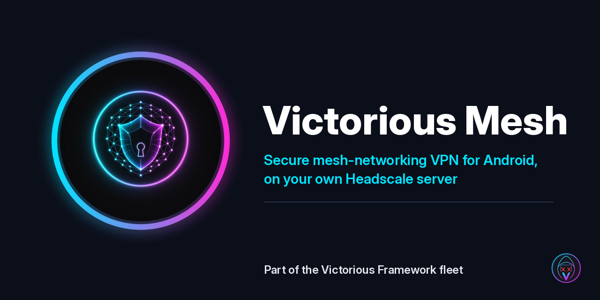

<div align="center">



# Victorious Mesh

**Secure mesh-networking VPN for Android, on your own Headscale server.**

Works on its own; fleet integration (droidcommand-AI) is optional

<p>
  <a href="https://github.com/Victorious93/victorious-mesh/releases"></a>
  <a href="LICENSE"></a>
  <a href="https://github.com/Victorious93/victorious-mesh/actions/workflows/android.yml"></a>
  <a href="https://victorious-framework.pages.dev"></a>
</p>

</div>

Victorious Mesh (`com.victorious.mesh`) connects your Android phone to a private
mesh network run by your own self-hosted [Headscale](https://headscale.net) control
server. There is no default server and no account with anyone else.

> **Testing status:** builds and JVM unit tests pass in CI. Nothing has been tested on a
> real device or against a real Headscale server yet, so every feature below is
> **[not device-verified]**.

## Features

Everything optional is **off by default**. Each item is described in the
[manual](docs/MANUAL.md).

- **Mesh VPN** to your Headscale server (Settings → Control server, HTTPS on port 443),
  with interactive login or a pre-auth key. Device list with search, pinning, ping and
  copy-address. Exit nodes, MagicDNS / split DNS, subnet routes and Mesh Drop file transfer.
- **WireGuard mode:** import a standard `.conf` (file, paste or QR image) and use it
  instead of the mesh. One tunnel at a time.
- **Kill switch** and **auto-connect**.
- **Proxy:** share this phone as an HTTP CONNECT / SOCKS5 exit on its mesh address
  only, or **force all traffic** through an upstream HTTP, HTTPS, SOCKS5, Tor or I2P
  proxy (fail-closed by default, DNS included).
- **Per-app routing:** each app can use the normal route, the exit node, its own saved
  proxy, or go Direct, with "block if its path is down".
- **DNS:** per-network DNS (by Wi-Fi name or mobile data) and **DNS tools** (lookups
  over UDP, TCP, DNS over TLS and DNS over HTTPS with verified certificates).
- **Leak checker** that labels every result as settings, observed or verified, and
  never reports a pass it didn't measure.
- **Mesh file share** (read-only, password-protected, mesh address only),
  **remote shell** shortcut (SSH app or Termux, no stored passwords) and
  **Wake-on-LAN**.
- **Connection log** (local, size-capped, no IP addresses), **battery saver**,
  **mesh speed / health** page, extra **Quick Settings tiles** and a home-screen widget.
- **Launcher shortcuts** for VictorLaunch: connect and disconnect, always behind an
  on-phone confirm dialog.
- **Privacy:** diagnostic log upload is permanently disabled; keys and saved
  credentials stay in encrypted storage on the phone; Android backup is off.
- **Fleet integration (optional):** droidcommand-AI can control the mesh over a
  Messenger bridge, but **only after you switch it on** in Settings. Callers are
  pinned by package and signing certificate, and destructive actions need a tap on the
  phone. Details: [docs/FLEET_BRIDGE.md](docs/FLEET_BRIDGE.md). The fleet theme from
  VictorLaunch is used when present; otherwise the built-in neon theme stays.

## Screenshots

No screenshots have been captured yet. Real ones will be added after testing on a
device; none of the images in this repo are app screenshots.

## Install / download

**Debug pre-release, not finished software.** It is signed with this repo's public
debug key. Install it only if you understand the risk.

- Release: [v0.1.0-debug](https://github.com/Victorious93/victorious-mesh/releases/tag/v0.1.0-debug)
  (pre-release, published 2026-10-30)
- APK: [`victorious-mesh-debug.apk`](https://github.com/Victorious93/victorious-mesh/releases/download/v0.1.0-debug/victorious-mesh-debug.apk)
  (about 69 MB; arm64-v8a and armeabi-v7a)

> **This APK is older than the feature list above.** It was built from commit
> `7e85ccd` (2026-10-27). Everything merged after that is **not** in it, including
> the hardened fleet receiver, per-app exit node / proxy choice, mesh file share,
> remote shell, Wake-on-LAN, per-network DNS, connection log, battery saver, launcher
> shortcuts, HTTPS / Tor / I2P proxies, DNS tools and the forced-proxy DNS fix.
> For those, use a newer CI build: every run of
> [Android CI](https://github.com/Victorious93/victorious-mesh/actions/workflows/android.yml)
> uploads a **`victorious-mesh-debug-apk`** artifact (needs a GitHub login), or build
> from source.

## Build from source

You need Go (the version in `go.mod`), gomobile (the build script installs it),
JDK 17+, the Android SDK (platform 36, build-tools 36.0.0) and NDK r26.

```sh
export ANDROID_HOME=/path/to/android-sdk
export ANDROID_NDK_HOME=$ANDROID_HOME/ndk/26.1.10909125
./scripts/build-aar.sh                     # Go core -> android/libs/libtailscale.aar
cd android
./gradlew assembleDebug                    # APK in android/build/outputs/apk/debug/
./gradlew testDebugUnitTest                # JVM unit tests
```

Debug builds are signed with the fixed debug keystore committed at
`android/keystore/victorious-mesh-debug.jks`, so local and CI builds match. Release
keys are supplied only through CI secrets and are never committed.

Package ids, versioning, signing fingerprints and other technical details are in
[docs/REFERENCE.md](docs/REFERENCE.md).

## Manual

The full user guide is [docs/MANUAL.md](docs/MANUAL.md). The same text is built into
the app: open **Help** from the main screen, or **Settings → Help / Manual**.

## Victorious fleet

Victorious Mesh is part of the [Victorious Framework](https://victorious-framework.pages.dev), a family of Android and PC tools by Don Victor. **It works standalone; fleet integrations are optional.** Related: [droidcommand-AI](https://github.com/Victorious93/droidcommand-AI), [victorlaunch](https://github.com/Victorious93/victorlaunch), [victorious-browser](https://github.com/Victorious93/victorious-browser). The roster is in [victorious-fleet](https://github.com/Victorious93/victorious-fleet) and live status is in [fleet-manifest](https://github.com/Victorious93/fleet-manifest).

## Contributing

Issues and pull requests are welcome. Please describe what you changed and why, and keep documentation accurate to the code — do not invent features, builds, or test results.

## License

BSD-3-Clause, with the upstream patent grant. See [LICENSE](LICENSE),
[PATENTS](PATENTS) and [NOTICE](NOTICE).

## Credits

Victorious Mesh is a Victorious Framework fork of
[tailscale/tailscale-android](https://github.com/tailscale/tailscale-android), with the
Go core from [tailscale/tailscale](https://github.com/tailscale/tailscale) and
WireGuard from `github.com/tailscale/wireguard-go` (MIT). The upstream copyright and
license are kept in [LICENSE](LICENSE), [PATENTS](PATENTS) and [NOTICE](NOTICE).
This project is not affiliated with or endorsed by the upstream authors. Upstream
trademarks and product names remain their owners'.
