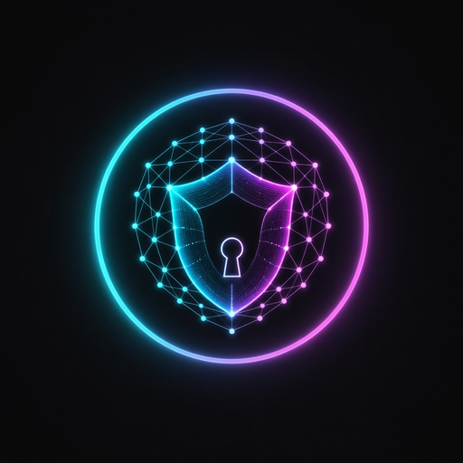

<p align="center">
  
</p>

# Victorious Mesh

Victorious Mesh is a secure mesh-networking / VPN app for Android
(`com.victorious.mesh`). It connects your phone to Don's private network, run by a
self-hosted [Headscale](https://headscale.net) control server.

> **Testing status:** builds and JVM unit tests pass locally and in CI. Nothing has been
> tested on a real device or against a real Headscale server yet.

## What it is

- A Tailscale/WireGuard-based client. It is a fork of the open-source
  [tailscale-android](https://github.com/tailscale/tailscale-android) app
  (BSD-3-Clause + PATENTS; credited in `NOTICE`, see also `LICENSE`, `PATENTS`).
- It owns the **one** Android `VpnService` for the whole fleet. Android allows only one
  VPN at a time, so other fleet apps go through this one rather than running their own.
- Point it at your server in **Settings → Control server**, e.g.
  `https://headscale.example.com`. The server **must be HTTPS on port 443**. There is no
  default server.
- Log in interactively, or with a **pre-auth key**
  (`headscale preauthkeys create --user USER`) on the same screen.
- Diagnostic log upload to Tailscale is permanently disabled.
- ABIs: arm64-v8a and armeabi-v7a.

## User manual

The full user guide is [docs/MANUAL.md](docs/MANUAL.md). The same document is bundled
into the app: open **Help** from the main screen, or **Settings → Help / Manual**.
Screenshot files are placeholders until they are captured (`images/manual/*.png`).

## Where it fits in the fleet

Victorious Mesh is an **EXTERNAL_NODE**. The fleet controller app
**droidcommand-AI** (`ai.droidcommand.app`) drives it:

- **Transport:** an Android Messenger bridge, intent action
  `com.victorious.mesh.action.BRIDGE` (package `com.victorious.mesh`).
- **Protocol:** the shared fleet JSON envelope, `protocol_major` 1, `protocol_minor` 1
  (remote-control envelope plus backward-compatible `mesh.*` ops).
- **Pairing:** by package name + signing-certificate SHA-256, checked on this side.
  Mesh does **not** share a signing key with the controller.
- **Allowlist:** `ai.droidcommand.app` and `ai.droidcommand.app.debug` (full
  access), each pinned to two certs: the droidcommand-AI debug cert
  (`88:00:51:A6:…:A0:C8:4D`) and the shared fleet release cert
  (`9E:A7:B3:14:…:F7:2D:8D`). **Victorious Browser** (`com.victorious.browser`)
  is a read-only consumer: `mesh.status` and `mesh.ip` / `mesh.ip.get` only
  (debug cert pinned; release TBD). Full values in
  [docs/FLEET_BRIDGE.md](docs/FLEET_BRIDGE.md). Mesh's own signing keys are separate.
- Each install has a permanent node id: `mesh-` + 32 lowercase hex characters.

### Operations

| Operation | What it does |
|---|---|
| `mesh.capabilities.get` / `capabilities.get` | Lists supported operations. Envelope form returns `{name, kind, remoteAllowed, requiresConfirm}` per op. Allowed even when the Settings switch is off. |
| `mesh.status` | Connection state, control server URL, mesh IPs |
| `mesh.up` | Turns the mesh on (refused until the user has opened the app once and approved the VPN) |
| `mesh.down` | Turns the mesh off. Via `remote.command` this is destructive and needs an on-phone tap. |
| `mesh.ip.get` | This phone's mesh IPv4 / IPv6 |
| `node.status.get` | Status-tray snapshot (canonical `BridgeRequest` + envelope fields in `parameters`). mesh / vpn / node_health. No keys or IPs. |
| `config.export` / `config.import` | This app's non-secret settings snapshot / restore (standalone `BridgeRequest`). Import needs on-phone confirm; never enables remote control. |
| `remote.command` / `macro.step` / `macro.run` | Envelope v1.1: dispatch a mesh action, or run steps (honour `onError`; `dryRun` validates only) |

**External control is OFF by default.** To turn it on, open the app, go to **Settings**,
and switch on **Allow fleet controller (droidcommand-AI)**.
Full details, errors and examples: [docs/FLEET_BRIDGE.md](docs/FLEET_BRIDGE.md).

## WireGuard profiles

How to import and use a standard WireGuard tunnel instead of the mesh:

1. Open **Settings → WireGuard**.
2. Add a profile:
   - **Import .conf** — pick a wg-quick file from the system picker, or
   - **Paste** — paste the `[Interface]` / `[Peer]` text, or
   - **QR image** — pick a screenshot or photo of a WireGuard QR code.
3. Rename or delete profiles from the card if you need to.
4. Tap **Connect**. Approve the Android VPN permission if asked. The card at the
   top shows **WireGuard · profile name** and **Connected**. The main screen also
   shows a banner while this mode is up.
5. Tap **Disconnect** to stop the tunnel, or **Switch back to mesh mode** to
   return the app to the mesh. Connecting the mesh from the main screen also
   turns WireGuard off first.

**One tunnel at a time.** Android allows one VPN per app. Mesh and WireGuard
never run together.

**What is used from the config:** `PrivateKey` (base64 or 64-character hex),
`Address`, `DNS` (IPs become DNS servers, names become search domains), `MTU`
(default 1280), `ListenPort`, and per peer `PublicKey`, `PresharedKey`,
`AllowedIPs` (installed as routes; at least one is required), `Endpoint` (host
names are resolved when connecting) and `PersistentKeepalive`. Linux-only
wg-quick keys (`PostUp`, `Table`, `FwMark`, …) are ignored. A full-tunnel config
(`AllowedIPs = 0.0.0.0/0` or `::/0`) with no `DNS` gets Cloudflare public DNS
so lookups are not sent into an empty resolver.

**Keys:** the whole config, including the private key, is stored only in the
app's EncryptedSharedPreferences (AES-256-GCM, master key in the Android
Keystore). Keys are never logged and never included in error messages.

**Fleet bridge:** no new operations. While WireGuard mode is active, `mesh.status`
reports the mesh as down (`connected: false`, no mesh IPs) and `mesh.up` is
refused until the user switches back to mesh mode in the app.

**How it works:** WireGuard runs inside the app's existing Go core using
`github.com/tailscale/wireguard-go` (MIT), on the same VpnService the mesh uses.
No second Go runtime and no extra native library is added.

## Proxy

**Settings → Proxy.** Off by default. **[not device-verified]**

**Share this phone:** other mesh nodes can use this phone as an HTTP CONNECT
or SOCKS5 exit. One port (default 1080) serves both, using the mesh engine's
built-in userspace listeners. The bind address is this node's mesh IPv4 only
— never `0.0.0.0`, Wi-Fi, or cellular. Optional username/password live in
EncryptedSharedPreferences. A persistent notification stays up while it
runs. WireGuard mode turns it off.

**Upstream:** HTTP on Android 10+ can still use advisory `setHttpProxy`
(apps may ignore it). **Force all traffic** (off by default) is a
TUN-to-SOCKS5/HTTP-CONNECT path in libtailscale: TCP goes through the
proxy with credentials; UDP uses SOCKS5 UDP ASSOCIATE or is blocked;
fail-closed blocks flows if the proxy drops. Literal non-mesh proxy IPs
are excluded from the VPN to avoid a loop. DNS and IPv6 remain limited
(see MANUAL). **[not device-verified]**

**Fleet bridge:** no new operations. The Orchestrator must ratify any later
remote control.

## Per-app routing

**Settings → Per-app routing.** **[not device-verified]**

**Feasible:** **Direct** (bypass VPN) vs **Mesh** via
`addDisallowedApplication` / the existing split-tunnel lists.

**Not per-app on one tunnel:** **Exit node** and **Upstream proxy** are
device-wide. The UI can remember a choice; those apps still use the single
mesh/exit/proxy.

**IP/location check:** on-demand GET to a configurable JSON endpoint. Runs
from this app, so it is not a true per-app vantage point for Direct apps.

**Traffic:** not tracked (would need usage-access). No GPS spoofing. No new
fleet operations.

## Kill switch

**Settings → Kill switch.** Off by default. **[not device-verified]**

When the mesh or WireGuard has been started, an unexpected drop holds a
blocking VPN (documentation-range dummy addresses) and reconnects.
Turning the main switch or Quick Settings tile off is an explicit leave.
Android Always-on VPN plus “Block connections without VPN” is the
stronger system lock. Another app taking the VPN slot cannot be held.
Direct apps still bypass. No new fleet operations.

## Auto-connect

**Settings → Auto-connect.** Off by default. **[not device-verified]**

Starts the last tunnel (mesh or the last WireGuard profile) when the
app opens or the phone finishes booting, if VPN permission was already
granted. Android 12+ may block a start from boot. Always-on VPN is
more reliable. No start before first unlock. No new fleet operations.

## Build and run

You need Go (version in `go.mod`), gomobile (the build script installs it), JDK 17+, Android SDK (platform 36, build-tools 36.0.0) and NDK r26.

```sh
export ANDROID_HOME=/path/to/android-sdk
export ANDROID_NDK_HOME=$ANDROID_HOME/ndk/26.1.10909125
./scripts/build-aar.sh                     # Go core -> android/libs/libtailscale.aar
cd android
./gradlew assembleDebug                    # APK in android/build/outputs/apk/debug/
./gradlew testDebugUnitTest                # JVM unit tests
```

Or skip the local build: every CI run uploads the debug APK as the
**`victorious-mesh-debug-apk`** artifact on the GitHub Actions run page.

## Versioning

`versionName` / `versionCode` are inherited from upstream Tailscale
(`tailscale.com/cmd/mkversion` writes `tailscale.version`; Gradle reads
`VERSION_LONG`). This is an **allowed fork exception**: Victorious Mesh does
not keep a separate version scheme. The Play/install `applicationId` remains
`com.victorious.mesh` and is not inherited.

## Android packages (fleet audit)

| What | Value | Notes |
|---|---|---|
| `applicationId` | `com.victorious.mesh` | Play / install id for debug and release. **Never change this.** |
| Gradle `namespace` | `com.victorious.mesh` | `R` and `BuildConfig` are generated here. |
| Kotlin/Java source package | `com.tailscale.ipn.*` | **Deferred.** See below. |
| Fleet bridge action | `com.victorious.mesh.action.BRIDGE` | Frozen string. |

### Why the Kotlin package was not moved

A full `com.tailscale.ipn` → `com.victorious.mesh` source move is deferred:

- The Go core is bound with gomobile as Java package `libtailscale` (see
  `scripts/build-aar.sh`). `App` implements `libtailscale.AppContext`. The Go
  side comments on `com.tailscale.ipn.App` as the app context; there is no
  `FindClass("com/tailscale/ipn/...")`, but renaming hundreds of Kotlin/Java
  files risks a silent interface / JNI break and a large upstream-merge
  conflict with tailscale-android.
- Manifest components use fully qualified `com.tailscale.ipn.*` names so they
  stay valid after the Gradle namespace change. There is no `FileProvider` /
  `android:authorities` that needs `${applicationId}`.

Safe in this change: Gradle `namespace`, `R` / `BuildConfig` imports, FQCN
manifest names, ProGuard keep for `com.victorious.mesh.R` / `BuildConfig`.
The committed debug keystore is unchanged; no release keys are added.

## Signing

- **Debug:** a fixed, committed debug key, so every build (local and CI) has the same
  signature: `android/keystore/victorious-mesh-debug.jks`, alias `victoriousmeshdebug`,
  SHA-256
  `F4:C9:25:B8:E8:0B:55:AB:83:E6:04:13:EE:49:86:57:DF:85:03:BB:30:D8:1F:9F:17:43:F2:2B:F5:36:B9:F4`.
- **Release:** the app's **own** release key, supplied only through CI secrets via
  `VM_RELEASE_STORE_FILE`, `VM_RELEASE_STORE_PASSWORD`, `VM_RELEASE_KEY_ALIAS` and
  `VM_RELEASE_KEY_PASSWORD`. It is not the shared fleet key and is never committed.
  (Whether those secrets are configured in the repo yet hasn't been checked: [Guessing].)
